<div align="center">

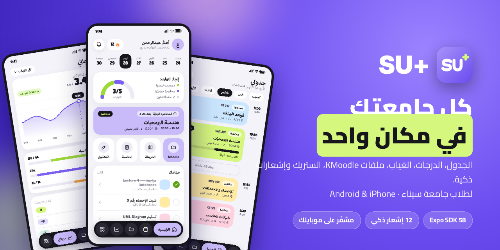

<br/>


# SU+ · SU Plus

### كل جامعتك في مكان واحد — *Your whole university, in one place.*

A student companion app for **Sinai University**, built with Expo and React Native for **Android** (Android only). Timetable, grades, transcript, absence, KMoodle files, study streak, planner and smart notifications all live in one app.

<br/>


<br/>


[**Features**](#-features) · [**Screens**](#-screens) · [**Notifications**](#-smart-notifications) · [**Architecture**](#-architecture) · [**Getting started**](#-getting-started) · [**Docs**](#-documentation) · [**Presentation**](docs/presentation/SU-Plus-Presentation.pdf)

</div>

---

## 📌 Overview

The university already has its systems: **UnicodeSIS** (the student portal) and **KMoodle** (course files). But they are separate websites that aren't built for a phone, and neither of them tells a student when something changes.

**SU+** pulls everything into one fast, Arabic-first mobile app:

| | |
|---|---|
| 🎓 **One sign-in** | The student signs in once on the university's own page, with the university Google account. The app never sees or stores the password. |
| 🔄 **Always fresh** | Light auto-sync while the app is open, a background sync about every 15 minutes, and a silent re-login when the session drops. |
| 🔔 **Tells you first** | 12 notification types: grades the moment they appear, absence and warnings, new lecture files, class and task reminders, and a study streak. Each type has its own switch. |
| 🔐 **Private by design** | Data is encrypted on the device (AES-GCM, with the key kept in the Keychain or Keystore). There is no backend that holds student data. |

> [!NOTE]
> SU+ is an independent student project. It is **not an official Sinai University app**, and it is not affiliated with or endorsed by the university.

<details>
<summary><b>🇪🇬 نبذة بالعربي</b></summary>

<br/>

**SU+** أبلكيشن لطلاب جامعة سيناء. بيجمع بوابة الجامعة (UnicodeSIS) وKMoodle في مكان واحد على الموبايل:

- الجدول
- الدرجات والسجل الأكاديمي والتراكمي
- الغياب والإنذارات
- ملفات المواد
- الستريك والمهام والكشكول

بتدخل مرة واحدة بإيميل الجامعة، والأبلكيشن مش بيشوف الباسورد ولا بيحفظه. كمان بيبعتلك 12 نوع إشعار، وكل نوع تقدر تقفله لوحده من الإعدادات:

- الدرجات أول ما تنزل
- الغياب والإنذارات
- الملفات الجديدة
- تذكير قبل المحاضرة
- ملخص المذاكرة

</details>

---

## ✨ Features

<table>
<tr>
<td width="50%" valign="top">

### 📚 Academics
- **Home dashboard:** today's progress ring, the next class with a countdown, quick tools and tasks.
- **Timetable:** each day by lecture or section, with room and instructor, and live "now" and "remaining" indicators.
- **Grades:** coursework, quiz, midterm and final per course, plus the CGPA trend.
- **Transcript:** **CGPA-first** term-by-term chart and earned hours.
- **Absence and warnings:** percentage per course against the 25% exclusion limit.
- **Registration, courses and the degree map:** done, available and locked courses on the way to graduation.

</td>
<td width="50%" valign="top">

### 🗂️ KMoodle
- Course **folders matched automatically** to your registered courses and doctors.
- Latest files, assignments, and old terms of the same course.
- In-app download and open, with progress.
- **New file and assignment alerts.**
- Silent token renewal with the remembered Google account.

</td>
</tr>
<tr>
<td valign="top">

### 🔥 Study system
- **Streak** with a daily goal (1–6 h), rest days and your longest streak.
- **Planner** of tasks with lead-time reminders.
- **Focus timer** and free-study sessions.
- **Weekly study chart** and an end-of-day summary.
- **Notebook** of course-tagged notes with search.

</td>
<td valign="top">

### 🧰 Tools and settings
- **GPA calculator** on the official university scale.
- **Term planner** with expected CGPA.
- Arabic / English, dark mode and a **fingerprint / Face ID lock**.
- A switch for each notification type, plus **masculine or feminine wording**.
- A **background-health card** for battery optimisation and maker auto-start.

</td>
</tr>
</table>

---

## 📱 Screens

> High-fidelity design screens of the SU+ 1.12 redesign, shown with **sample data**.

<table>
<tr>
<td align="center">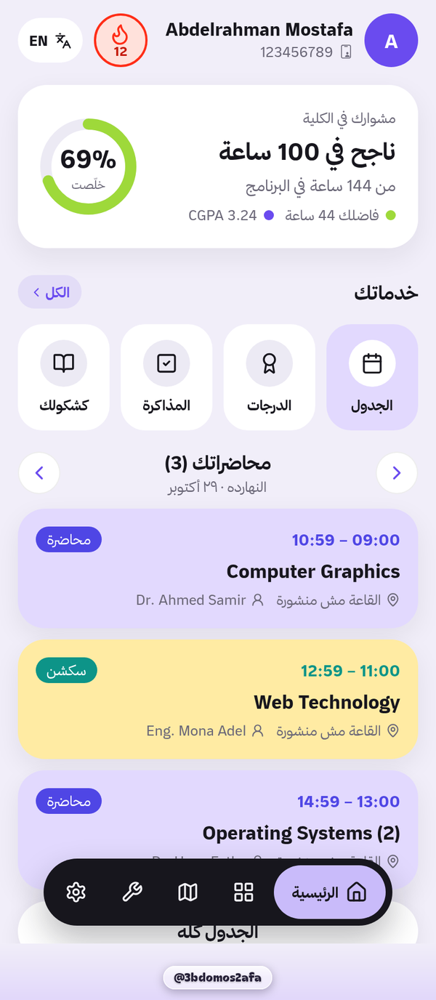<br/><sub><b>Home</b></sub></td>
<td align="center">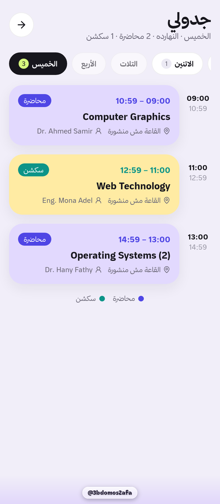<br/><sub><b>Timetable</b></sub></td>
<td align="center">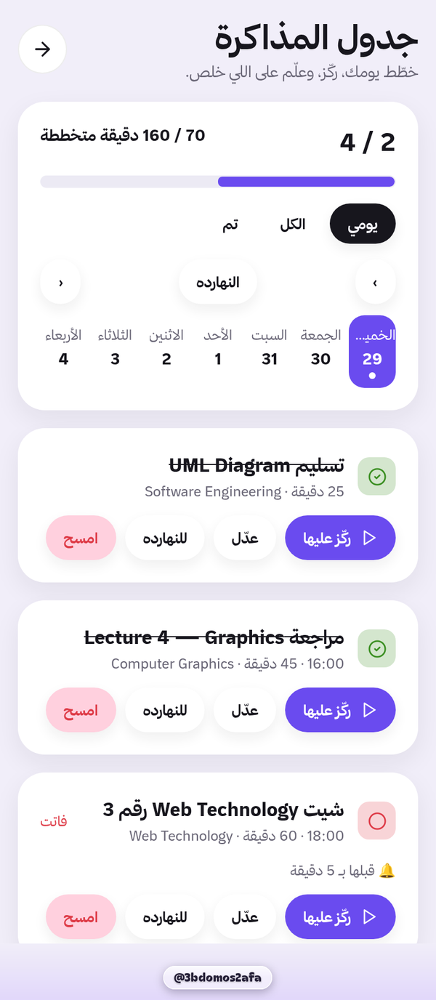<br/><sub><b>Study plan</b></sub></td>
<td align="center">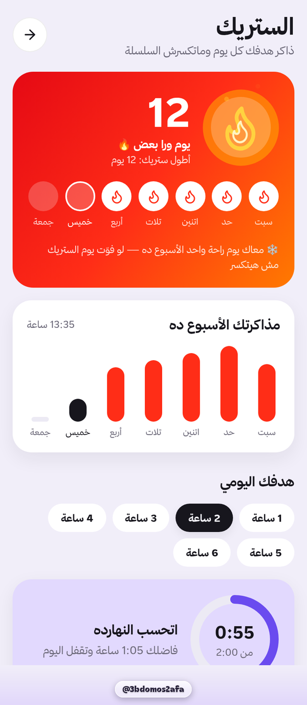<br/><sub><b>Streak</b></sub></td>
</tr>
<tr>
<td align="center">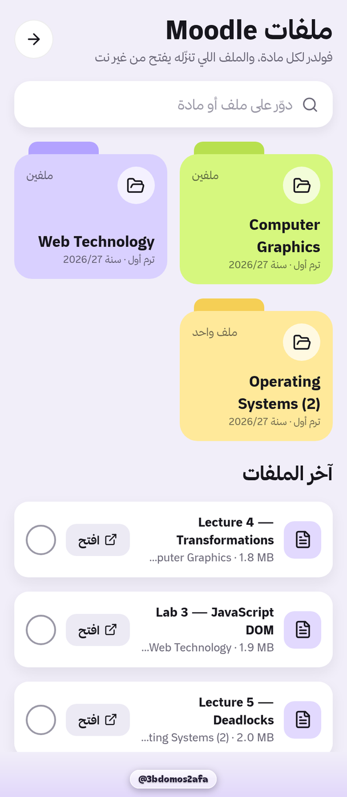<br/><sub><b>KMoodle files</b></sub></td>
<td align="center">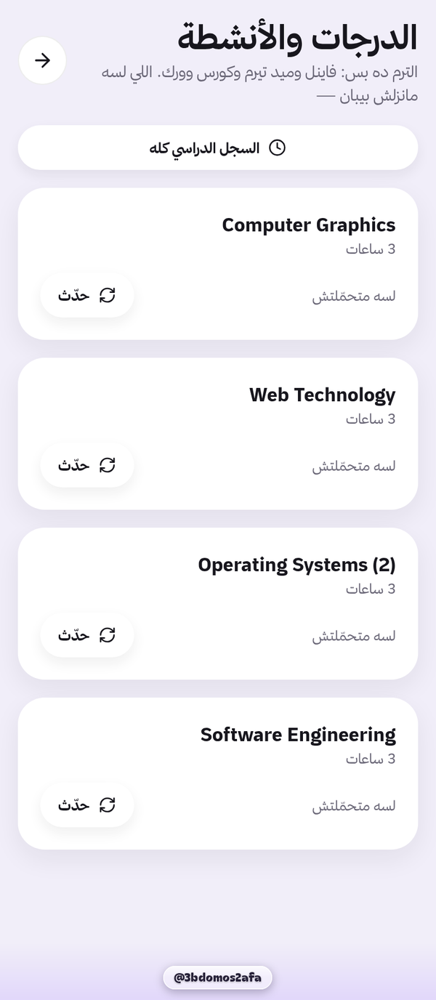<br/><sub><b>Grades</b></sub></td>
<td align="center">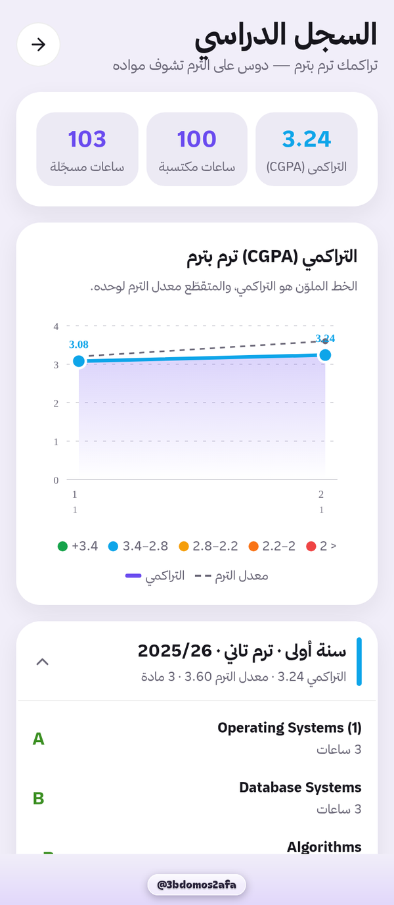<br/><sub><b>Transcript</b></sub></td>
<td align="center">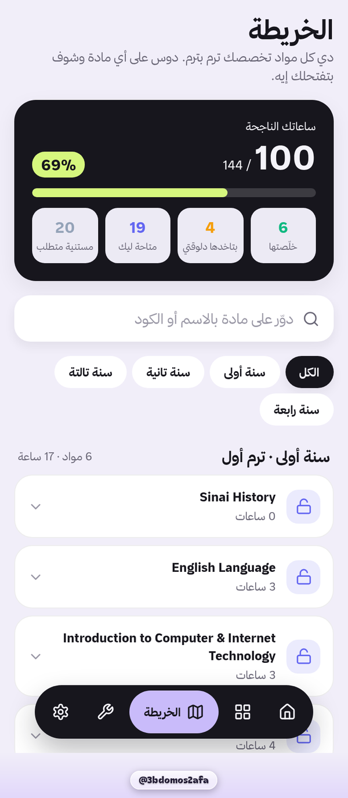<br/><sub><b>Degree map</b></sub></td>
</tr>
<tr>
<td align="center">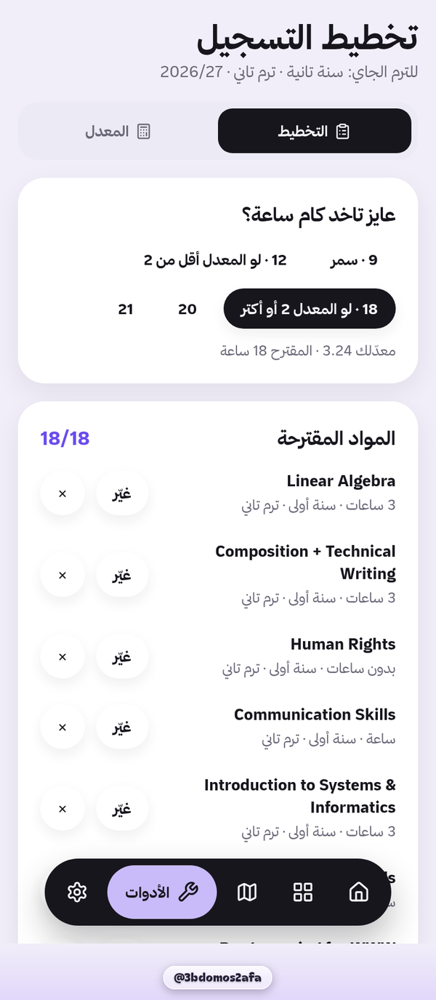<br/><sub><b>Tools · GPA</b></sub></td>
<td align="center">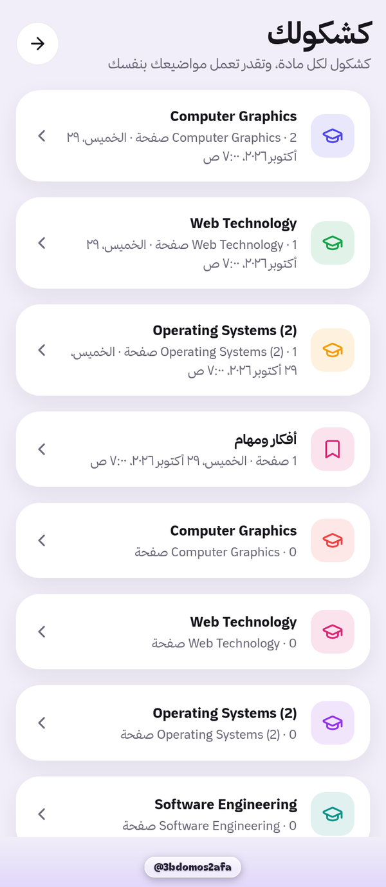<br/><sub><b>Notebook</b></sub></td>
<td align="center">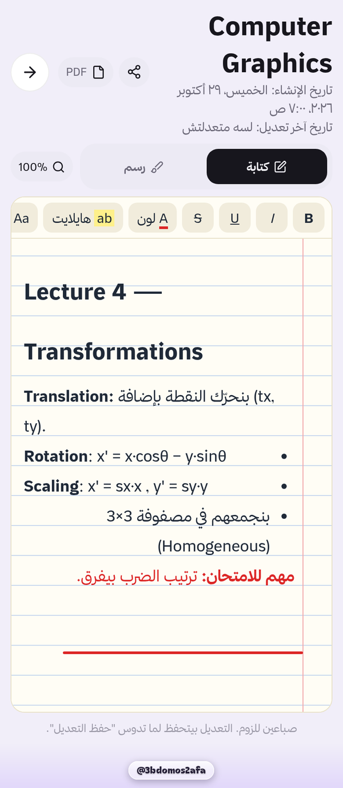<br/><sub><b>Notebook page</b></sub></td>
<td align="center">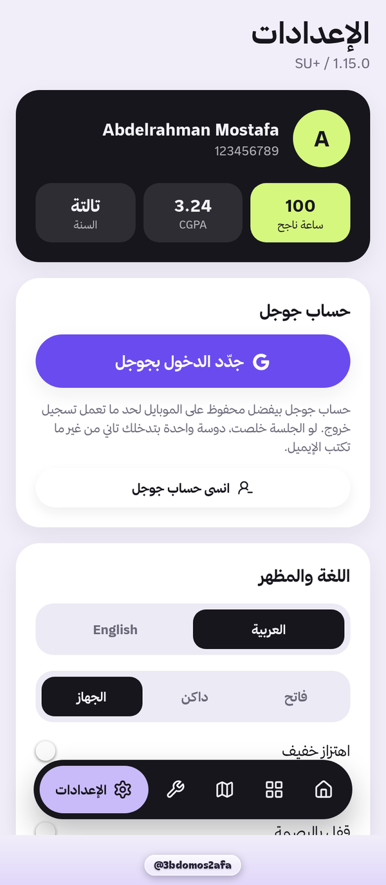<br/><sub><b>Settings</b></sub></td>
</tr>
</table>

The full design system (colors, icons, type and motion) is in [docs/DESIGN.md](docs/DESIGN.md).

---

## 🔔 Smart notifications

| # | When | Example (Arabic UI) |
|:-:|---|---|
| N1 | Every day at 07:00 | عليك النهاردة محاضرة X الساعة 9:00 وسكشن Y الساعة 12:45 |
| N2 | 10 minutes before a class | عليك سكشن كمان 10 دقايق في روم B204 ودكتور Y |
| N3 | Coursework grade posted | درجة الكورس ورك نزلت مادة X |
| N4 | Midterm grade posted | استر يا ستااار درجات الميد ظهرت |
| N5 | Final grade posted | استر يا ستااار درجات الفاينل ظهرت |
| N6 | Each new absence | انت غبت محاضرة X ونسبة الغياب وصلت 15% |
| N7 | Attendance warning | جالك انذار اول 10% في مادة X |
| N8 | Before a planned task | جاهز ل… بعد 15 دقيقة |
| N9 | Streak at risk (21:00 / 22:00 / 23:30) | الاستريك هيضيع روح ذاكر |
| N10 | Task still undone 2 h later | متراكمش المذاكرة عشان هتندم |
| N11 | End-of-day summary | عاش ذاكرت النهاردة 3س 20د |
| N12 | New KMoodle file or assignment | الدكتور X رفع المحاضرة … مادة … |

- Every type has its own switch in **Settings → Notifications**.
- The wording follows the student's gender (taken from the university profile, or set by hand).
- There are **no noisy "synced" pings**.

How delivery, background sync, and Android and iOS limits work is in [docs/NOTIFICATIONS.md](docs/NOTIFICATIONS.md).

---

## 🏗️ Architecture

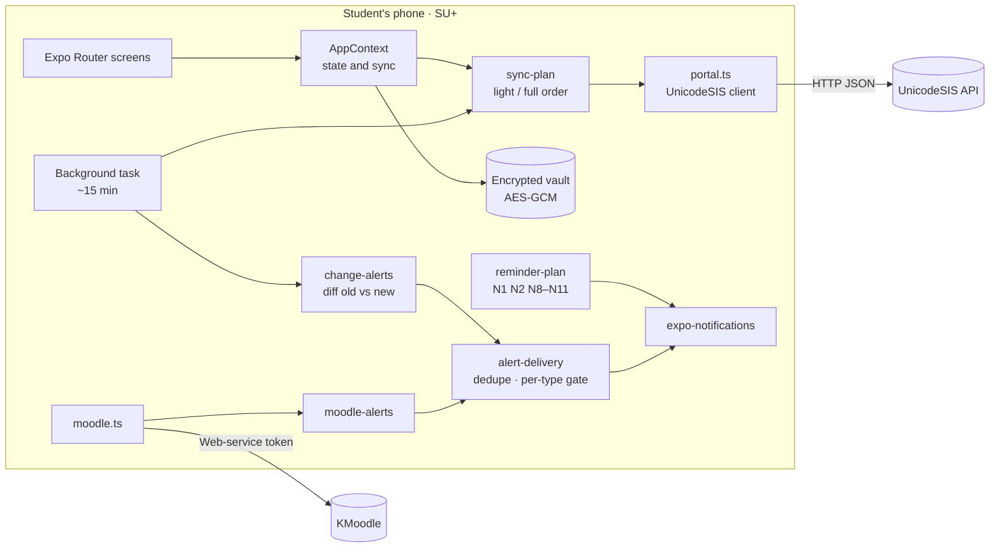

The layers, modules, data flow and storage are in [docs/ARCHITECTURE.md](docs/ARCHITECTURE.md).

### Tech stack

| Area | Technology |
|---|---|
| App | **Expo SDK 58**, React Native (New Architecture), **TypeScript**, Expo Router |
| UI | react-native-svg charts, Reanimated, Lucide-style icons, a custom RTL design system |
| Data | UnicodeSIS REST client, KMoodle web services, `react-native-webview` for portal sign-in |
| Background | `expo-background-task`, `expo-task-manager`, `expo-notifications` (exact alarms on Android) |
| Security | `expo-secure-store` + `@noble/ciphers` AES-GCM vault, `expo-local-authentication` |
| Native | Kotlin Expo module **SuFocus** (focus and battery health) and a Java WebView popup through a config plugin |
| Quality | Node test runner + `tsx` (**137 tests, 27 suites**), build preflight, `expo-doctor` |
| Delivery | **EAS Build** (`preview`: Android APK and iOS internal) |

---

## 🚀 Getting started

**Prerequisites:**
- Node.js 24 and npm.
- An Expo account with access to `@x3bdoxs-team/abdelrahman`.
- For an iPhone build: an Apple Developer account.

```sh
npm ci                       # install exact, locked dependencies
npm run typecheck            # tsc --noEmit
npm test                     # 137 unit tests
npm run preflight            # release integrity checks
npx expo start               # run in development

# cloud builds (EAS)
npx eas-cli@latest build --profile preview --platform android
npx eas-cli@latest build --profile preview --platform ios
```

> [!IMPORTANT]
> - Builds from 1.12.0 onward use a **new signing key**, so uninstall the old app before installing.
> - Notification permissions and native plugins changed in 1.13–1.14, so you need a **new native build**. An OTA update is not enough.

Profiles, fonts, checks and troubleshooting are in [docs/BUILD.md](docs/BUILD.md).

---

## 📂 Project structure

```text
su-student/
├─ src/
│  ├─ app/              # Expo Router screens: (tabs), transcript, grades, moodle, streak, …
│  ├─ components/       # UI kit, charts, portal sign-in, reminders, background-health
│  ├─ context/          # AppContext: session, cache, sync orchestration
│  ├─ lib/              # 47 modules: portal, academic, moodle, notifications, vault, …
│  └─ data/             # static data (scales, maps, samples)
├─ modules/su-focus/    # native Kotlin Expo module (Android)
├─ plugins/             # Expo config plugins (Google popup, network, no-minify)
├─ server/              # optional Google SSO broker (Node) and its tests
├─ scripts/             # preflight, source verification, fonts, build helpers
├─ tests/               # 27 test suites
└─ docs/                # this documentation and the presentation
```

---

## 🛡️ Privacy and security

- **No password handling:** sign-in happens on the university's own page, and the app captures only the session.
- **Encrypted at rest:** every cached record is AES-GCM encrypted, with the key in the platform Keychain or Keystore.
- **No student-data server:** the app talks directly to UnicodeSIS and KMoodle from the phone.
- **Strict sign-in sandbox:** the Google popup allows only Google-owned HTTPS hosts and the portal, with no JS bridges.
- **Optional app lock** with fingerprint or Face ID.

The full details are in [docs/SECURITY.md](docs/SECURITY.md).

---

## 📖 Documentation

| Document | What's inside |
|---|---|
| [ARCHITECTURE](docs/ARCHITECTURE.md) | Layers, modules map, sync engine, storage, diagrams |
| [FEATURES](docs/FEATURES.md) | Every screen and what it does |
| [NOTIFICATIONS](docs/NOTIFICATIONS.md) | N1–N12, scheduling, background sync, battery, iOS limits |
| [UNIVERSITY-API](docs/UNIVERSITY-API.md) | UnicodeSIS endpoints, transcript chain, GPA scale, KMoodle |
| [SECURITY](docs/SECURITY.md) | Threat model, vault, sign-in sandbox |
| [DESIGN](docs/DESIGN.md) | Brand, palette, icons, typography, motion |
| [BUILD](docs/BUILD.md) | EAS profiles, release checks, troubleshooting |
| [TESTING](docs/TESTING.md) | Test suites and what they guard |
| [CHANGELOG](CHANGELOG.md) | Version history |
| [🎞️ Presentation (PDF)](docs/presentation/SU-Plus-Presentation.pdf) | The project in 12 slides ([HTML source](docs/presentation/index.html)) |

<div align="center">
<br/>
<a href="docs/presentation/SU-Plus-Presentation.pdf">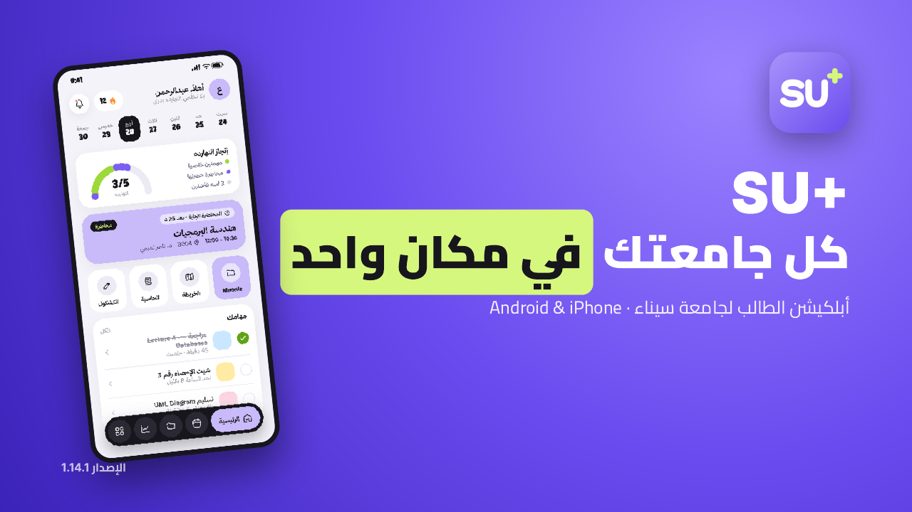</a>
<br/><sub>Click to open the presentation</sub>
</div>

---

<div align="center">

Made with 💜 for Sinai University students · **SU+ 1.15.0**

</div>