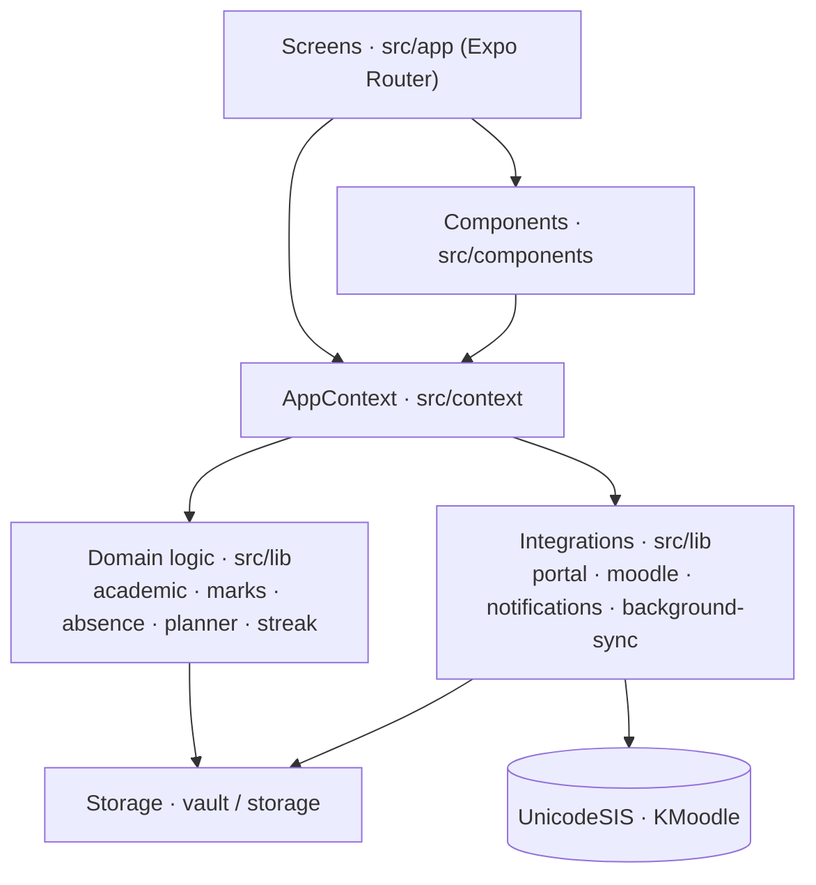
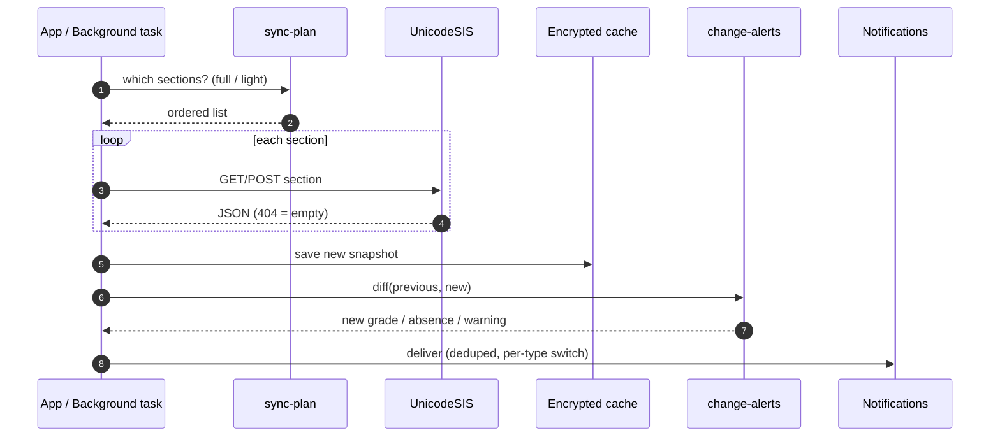

# 🏗️ Architecture

[← Back to README](../README.md)

SU+ is a **client-only** mobile app. All logic runs on the phone. The phone talks directly to the university systems and keeps an encrypted local cache. An optional SSO broker exists in `server/`, but the app does not need it.

## Contents
- [Layers](#layers)
- [Module map](#module-map)
- [Sync engine](#sync-engine)
- [Change detection and alerts](#change-detection-and-alerts)
- [Storage](#storage)
- [Native pieces](#native-pieces)

## Layers

| Layer | Responsibility |
|---|---|
| **Screens** | Navigation and layout only. They read state from `AppContext`. |
| **Components** | The reusable UI kit (`ui.tsx`, `chrome.tsx`), charts (`gpa-chart`, `bars`), the portal sign-in WebView, reminder controller and settings. |
| **AppContext** | Session, cached data, sync status, preferences, `refreshAll(full)`, auto-sync and alert delivery after sync. |
| **Domain logic** | Pure functions, all unit-tested: GPA, marks parsing, absence %, term labels, planner, streak, reminder plan. |
| **Integrations** | HTTP clients and OS services: portal, KMoodle, notifications, background task. |

## Module map

| Module | Purpose |
|---|---|
| `portal.ts` | UnicodeSIS client: requests, session handling, 404 means "no data" |
| `academic.ts` | Normalises portal sections into courses, slots and terms |
| `marks.ts` / `absence.ts` | Grade parts (coursework, quiz, midterm, final) and absence percentages |
| `student.ts` | Profile, current courses, student code |
| `sync-plan.ts` | `SYNC_ORDER` (full), `autoOrder` (light), `backgroundOrder` |
| `change-alerts.ts` | `diffAlerts(prev, next)` turns two caches into alerts N3–N7 |
| `alert-delivery.ts` | De-duplicates against the seen list, gates each alert by type, batches more than 5 |
| `reminder-plan.ts` | Builds scheduled reminders N1, N2, N8–N11 (capped at 60) |
| `notify-text.ts` | All notification wording, gender-aware (`say.*`) |
| `moodle*.ts` | KMoodle client, course matching, downloads, N12 alerts |
| `background-sync.ts` | Background task: light sync, diff, deliver, KMoodle check |
| `vault.ts` | AES-GCM encrypted storage |
| `battery-vendor.ts` | Maker-specific background guidance (Xiaomi, Samsung, Oppo, Vivo, Huawei) |

## Sync engine

| Trigger | Mode |
|---|---|
| App opened or resumed | **Light** (`autoOrder`): profile, frequently changing sections, absence every 6 h |
| Pull-to-refresh | **Full** (`SYNC_ORDER`) |
| Background task (about 15 min) | **Light**, plus a KMoodle check |
| Session expired while online | Silent re-login, then sync (`silent-relogin.tsx`) |

## Change detection and alerts

Alerts are computed by **diffing** the previous and new cache. The app never asks the server what changed, so it works with the portal as it is.

- **Stable ids** (for example `abs:<course>:<pct>`) mean the same change is never notified twice. A seen list of the last 600 ids is kept per student.
- **The first KMoodle load is a silent baseline**, so installing the app does not flood the student with "new file" alerts.

## Storage

| Data | Where |
|---|---|
| Encryption key | Android Keystore via `expo-secure-store` |
| Cached portal data, KMoodle data, study state | AsyncStorage, **AES-GCM ciphertext only** |
| Web preview | Memory only, never persisted |

## Native pieces

- **`modules/su-focus`:** a Kotlin Expo module that provides the focus status notification and the background-health functions:
  - `batteryStatus`
  - `requestUnrestricted`
  - `openAutostart`
  - `openAppSettings`
- **`plugins/with-google-webview-test.cjs`:** injects a hardened Java popup for Google sign-in inside the portal WebView. Only Google-owned HTTPS hosts and the portal are allowed, and the popup closes automatically on hand-off.
- **`plugins/with-portal-network.cjs`:** Android network security config for the portal host.