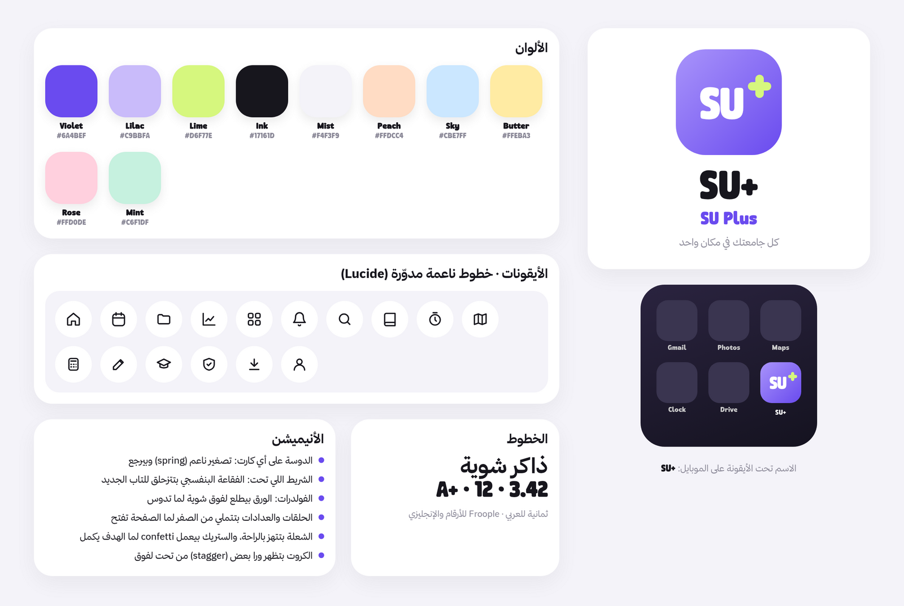

# 🎨 Design system

[← Back to README](../README.md)

## Brand

- **Name:** SU+ ("SU Plus"). The home-screen label is **SU+**.
- **Tagline:** كل جامعتك في مكان واحد ("Your whole university, in one place").
- **Icon:** a violet squircle with a white **SU** and a lime **+**.

## Palette

| Token | Hex | Use |
|---|---|---|
| Violet | `#6A4BEF` | Primary actions, CGPA line, active state |
| Lilac | `#C9BBFA` | Active tab pill, lecture cards |
| Lime | `#D6F77E` | Highlights, "now" badges, success |
| Ink | `#17161D` | Tab bar, headings, primary buttons |
| Mist | `#F4F3F9` | App background |
| Peach | `#FFDCC4` | Streak card |
| Sky | `#CBE7FF` | Lecture cards |
| Butter | `#FFEBA3` | Section cards |
| Rose | `#FFD0DE` | Course cards |
| Mint | `#C6F1DF` | Notes, success |

## Icons

Lucide-style icons: soft, rounded 2-px strokes, drawn with `react-native-svg`.

## Typography

- **Arabic:** Thmanyah Sans (Regular / Bold) when bundled, with **Cairo** as the fallback.
- **Latin and numbers:** Froople when bundled, with **Inter** as the fallback.

Fonts are optional local files and are never committed. `scripts/prepare-fonts.cjs` picks the right set at install time.

## Motion

- Spring press-scale on cards.
- An animated tab bubble.
- Rings and counters that fill from zero.
- Staggered card entrance.
- Confetti when the daily goal is met.

## Layout rules

- **RTL-first:** every screen is designed in Arabic and mirrors for English.
- A dark pill tab bar floats above the content.
- Large rounded cards (24 px radius) with generous whitespace.