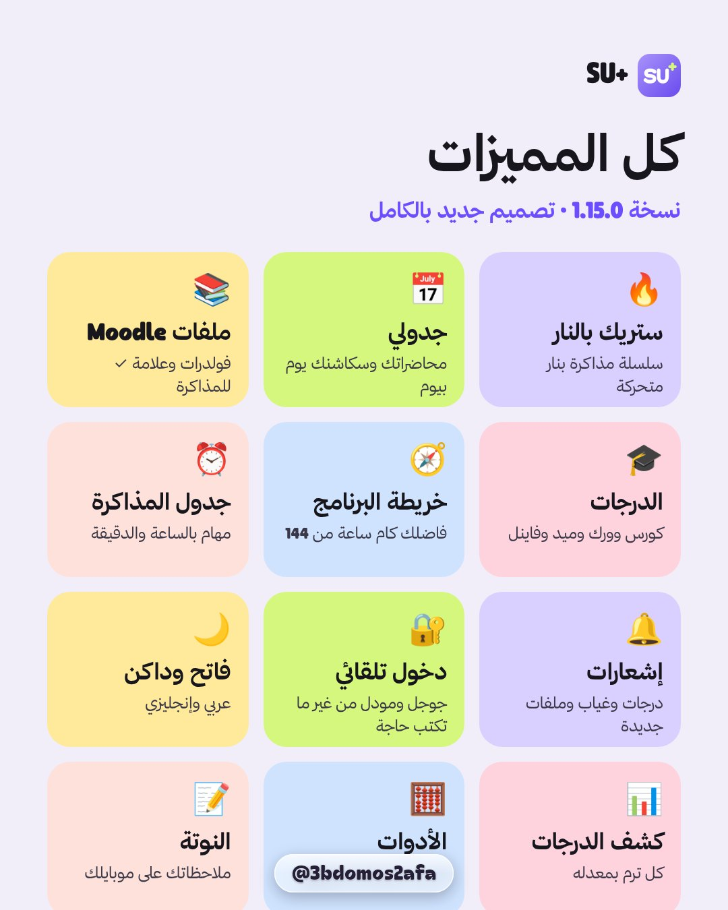

# 🎨 Design system

[← Back to README](../README.md)

## Brand

- **Name:** SU+ ("SU Plus"). The home-screen label is **SU+**.
- **Tagline:** كل جامعتك في مكان واحد ("Your whole university, in one place").
- **Icon:** a violet squircle with a white **SU** and a lime **+**.

## Palette

| Token | Hex | Use |
|---|---|---|
| Violet | `#6A4BEF` | Primary actions, CGPA line, active state |
| Lilac | `#C9BBFA` | Active tab pill, lecture cards |
| Lime | `#D6F77E` | Highlights, "now" badges, success |
| Ink | `#17161D` | Tab bar, headings, primary buttons |
| Lavender | `#F1EEF9` | App background |
| Fire | `#E5242B` → `#FF7A1A` | Streak card and badge |
| Sky | `#CBE7FF` | Lecture cards |
| Butter | `#FFEBA3` | Section cards |
| Rose | `#FFD0DE` | Course cards |
| Mint | `#C6F1DF` | Notes, success |

## Icons

Lucide-style icons: soft, rounded 2-px strokes, drawn with `react-native-svg`.

## Typography

- **Arabic:** Thmanyah Sans (Regular / Bold).
- **Latin and numbers:** Froople.

Both are bundled in `assets/fonts/` with the Thmanyah licence.

## Motion

- Spring press-scale on cards.
- An animated tab bubble.
- The "today's progress" gauge and counters that fill from zero.
- An animated fire (flicker, glow and sparks) on the streak card and badge.
- Staggered card entrance.
- Confetti when the daily goal is met.

## Layout rules

- **RTL-first:** every screen is designed in Arabic and mirrors for English.
- A black pill tab bar floats above the content; selected chips and tabs are black.
- Round 44 px back button next to each page title.
- No course codes on any screen.
- Large rounded cards (24 px radius) with generous whitespace.