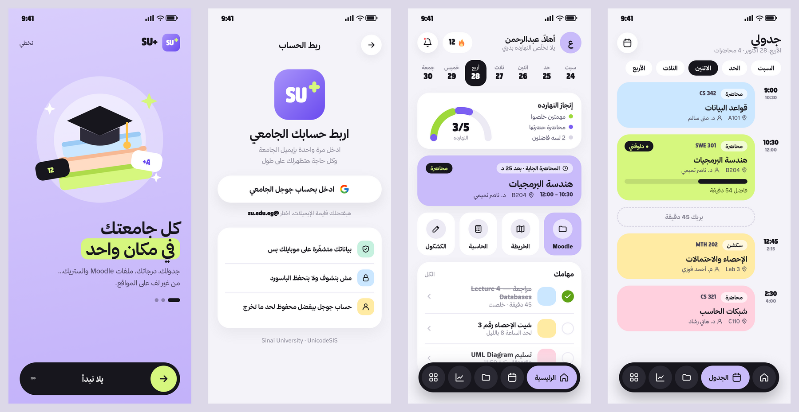
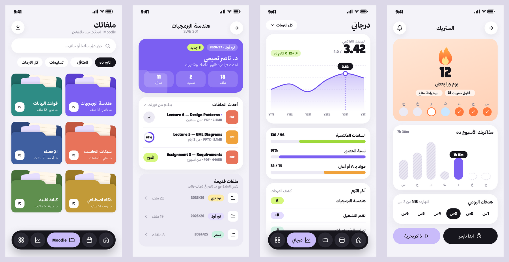
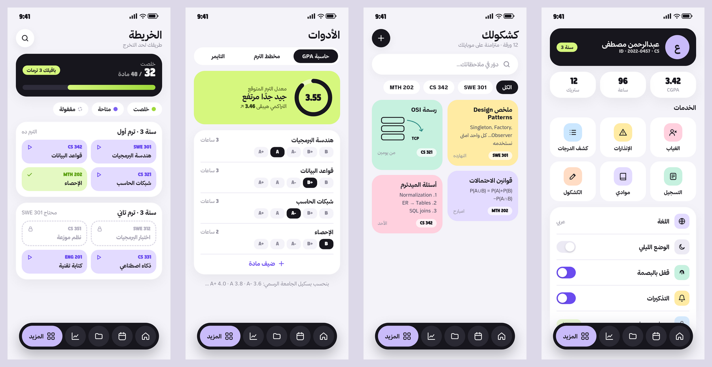

# ✨ Features — screen by screen

[← Back to README](../README.md)

The screens are taken from the SU+ 1.12 design and show sample data.

## Tabs

| Tab | What it shows |
|---|---|
| **Home** | Greeting, a week strip, a "today's progress" ring, the next class card with its countdown, quick tools (KMoodle, map, calculator, notebook) and today's tasks |
| **Timetable** | The day picker plus lecture and section cards with time, room and instructor. The current class shows a "now" badge and remaining time, and breaks are shown between classes |
| **Files (KMoodle)** | Course folders filtered by this term, downloaded, assignments or all terms, plus search |
| **Grades** | CGPA with its trend chart, earned hours, attendance %, courses with A or higher, and the latest term |
| **More** | Profile card (CGPA, hours, streak), services and settings |

## Academic screens

- **Transcript (السجل):**
  - The **CGPA is the main line**, with term GPA dashed.
  - Each term expands to show its courses.
  - Points and hours are shown per term.
- **Grades (كشف الدرجات):** coursework, quiz, midterm and final per course.
- **Absence (الغياب):** percentage per course and lecture or section split, against the 25% exclusion limit.
- **Warnings (الإنذارات):** first (10%) and second (20%) warnings.
- **Registration and Courses:** registered courses and instructors.
- **Progress and Degree map:** done, available and locked courses, terms left, and prerequisites.

## KMoodle

- Folders are matched automatically to registered courses and their doctors.
- **Latest files** with type (PDF or PPTX), size and download progress.
- **Old files** from the same course in previous terms.
- **Assignments** are highlighted, and new uploads trigger N12.

## Study system

- **Streak:**
  - Day chain, rest days and longest streak.
  - A daily goal from 1 to 6 hours.
  - A weekly chart.
  - Confetti when the goal is reached.
- **Planner (plan tab):** tasks with a lead-time reminder (N8) and an "undone" nudge (N10).
- **Focus timer and free study:** the time counts toward the streak and the daily summary (N11).
- **Notebook (الكشكول):** course-tagged notes, synced on the phone, with search.

## Tools

- **GPA calculator** on the official scale: A+ 4.0 · A 3.8 · A- 3.6 · B+ 3.3 · B 3.0 · C+ 2.7 · C 2.4 · D 2.0 · F 0.
- **Term planner** that shows the expected term GPA and the resulting CGPA.
- **Timer**.

## Settings

- Language (Arabic / English), dark mode, and fingerprint / Face ID lock.
- **Notifications:** a master switch, 12 per-type switches and a gender selector (auto / male / female).
- **Background notifications card:**
  - Shows whether Android is restricting SU+.
  - Opens the official "allow in background" dialog.
  - Shows maker-specific steps for Xiaomi, Samsung, Oppo/Realme, Vivo and Huawei/Honor.