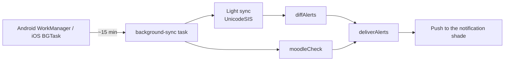

# 🔔 Notifications

[← Back to README](../README.md)

## Two kinds of notifications

| Kind | Types | How |
|---|---|---|
| **Scheduled** (known in advance) | N1 daily, N2 class, N8 task, N9 streak, N10 overdue, N11 summary | `reminder-plan.ts` builds up to 60 local notifications. Loud and class items use Android **alarm-clock** delivery, so they fire on time even in Doze. |
| **Change alerts** (discovered by sync) | N3 coursework, N4 midterm, N5 final, N6 absence, N7 warning, N12 KMoodle | Sync, then `diffAlerts` or `moodleAlerts`, then `deliverAlerts`: de-duplicated, gated by type, and batched when there are more than 5. |

## The 12 types

| # | Switch | Trigger | Text |
|:-:|---|---|---|
| N1 | Daily | 07:00 on days with classes | عليك النهاردة محاضرة X الساعة … وسكشن Y الساعة … |
| N2 | Classes | 10 minutes before a class | عليك سكشن/محاضرة كمان 10 دقايق في روم X ودكتور Y |
| N3 | Coursework | New coursework or quiz mark | درجة الكورس ورك نزلت مادة X |
| N4 | Midterm | New midterm mark | استر يا ستااار درجات الميد ظهرت |
| N5 | Final | New final result | استر يا ستااار درجات الفاينل ظهرت |
| N6 | Absence | Absence % increased | انت غبت محاضرة/سيكشن X ونسبة الغياب وصلت x% |
| N7 | Warnings | A new warning | جالك انذار اول 10% / تاني 20% في مادة X |
| N8 | Tasks | The student's lead time before a task | جاهز ل … بعد … |
| N9 | Streak | 21:00 and 22:00 while the goal isn't met; 23:30 if 0 minutes were studied | الاستريك هيضيع روح ذاكر · يابنى روح ذاكر هتندم والله · نام نام ضيعت اليوم… |
| N10 | Overdue | 2 h after an undone task | متراكمش المذاكرة عشان هتندم |
| N11 | Summary | 23:45 | under 1 h · 1–3 h · 3–4 h · 4 h or more (four different messages) |
| N12 | KMoodle | New file or assignment | الدكتور X رفع المحاضرة/اسايمنت … مادة … |

The wording is **gender-aware**: انت غبت becomes انتي غبتي for a female student. Gender comes from the university profile, and the student can override it in Settings.

## Background sync

| Platform | Reality |
|---|---|
| **Android** | The minimum interval is 15 minutes. Battery optimisation and maker "auto-start" managers can delay or kill it, so the Settings **background-health card** guides the student to exempt SU+. A typical grade alert arrives within 15–30 minutes. |
| **iOS** | iOS decides when background fetch runs, based on how often the student opens the app. Alerts may wait until the app is opened. |

There is no persistent notification and no server, which is why the app polls instead of receiving pushes.

## Holidays (no timetable)

- With no slots, **N1 and N2 don't fire**.
- The streak, planner, summary and KMoodle notifications keep working.
- Grade alerts still arrive whenever the portal updates.

## Quiet by design

The app never sends notifications like "synced", "update done" or "sign in again". An expired session is renewed silently.