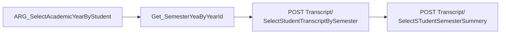

# 🎓 University systems

[← Back to README](../README.md)

## UnicodeSIS (student portal)

| Item | Value |
|---|---|
| Base URL | `http://unicodesis.su.edu.eg:150///api/` (the triple slash is required) |
| Empty result | HTTP **404** means "no data" and is not an error |
| Sections | Cached as `SEC_*` keys: `SEC_PROFILE`, `SEC_PERSONAL`, `SEC_ATTENDANCE`, `SEC_WARNINGS`, `SEC_ABSENCE`, … |
| Student code | `SEC_PROFILE → StudentData[0].StudentCode` |
| Gender | `GenderName` in `SEC_PERSONAL` / `SEC_PROFILE` |
| Timetable | `SubTypeID` **3 = lecture**, **4 = section** |

### Transcript chain

The spelling of the endpoints is the university's own and is used as-is.

### GPA scale

| A+ | A | A- | B+ | B | C+ | C | D | F |
|:--:|:--:|:--:|:--:|:--:|:--:|:--:|:--:|:--:|
| 4.0 | 3.8 | 3.6 | 3.3 | 3.0 | 2.7 | 2.4 | 2.0 | 0 |

A **third attempt** of a course is capped at **D**.

## KMoodle

| Item | Value |
|---|---|
| Host | `https://kmoodle.su.edu.eg` |
| Sign-in | Google IdP, then the Moodle **mobile web-service token** (`moodlemobile://` launch) |
| Expiry | `MoodleError('expired')` triggers a silent renewal in a hidden WebView with the remembered Google account |
| Matching | `moodle-match.ts` maps Moodle courses to registered course codes and instructors |